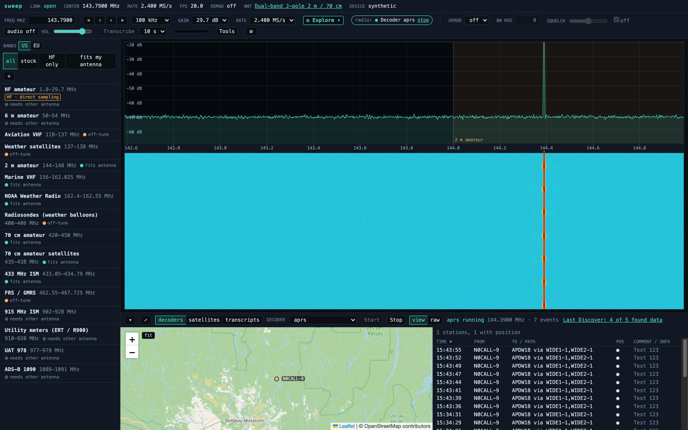
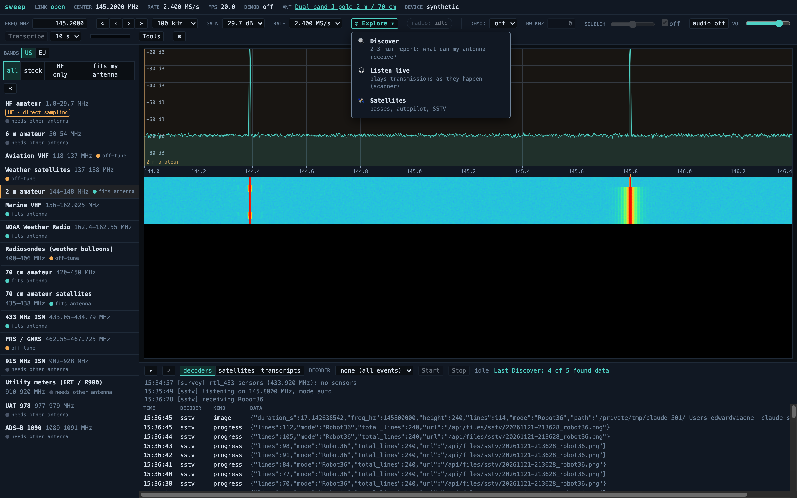
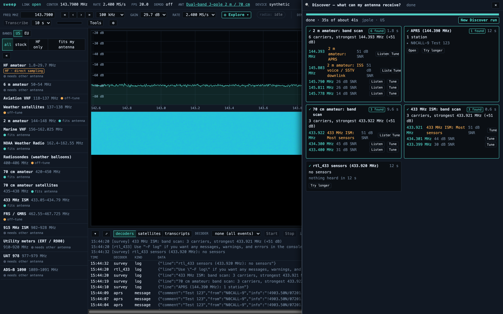
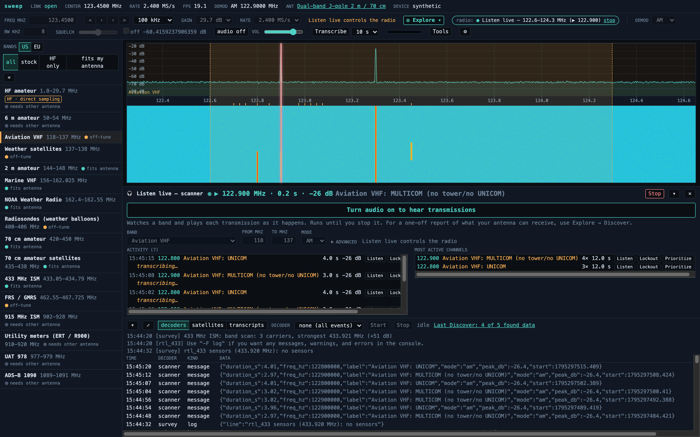
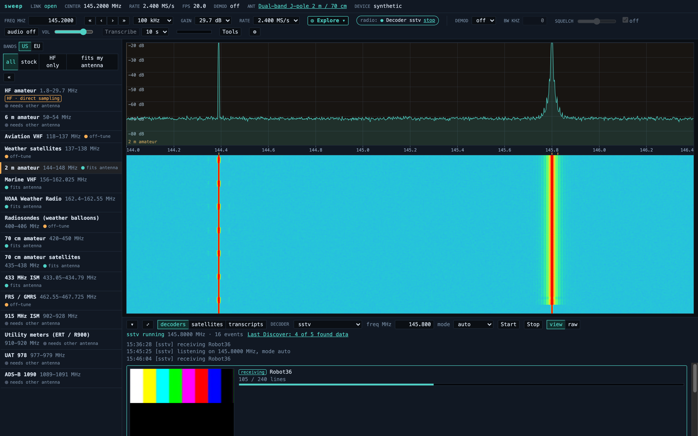

# sweep

A local RTL-SDR control station for macOS. It gives you a live spectrum and waterfall, a band catalog (US and EU), audio in the browser, and one-click decoders: aircraft, weather data, packet radio, ships, sensors, satellites and SSTV pictures. It can also listen to a band and play each transmission as it happens, transcribing it locally. Everything the UI does is also available over an HTTP/WebSocket API and the `sdrctl` CLI, so scripts and agents can drive the radio.

**Receive only.** There is no transmit code.

Built and tested with a Nooelec NESDR SMArt v5 (RTL2832U + R820T, 0.5 ppm TCXO) on an Apple Silicon Mac.



<sub>All screenshots come from the built-in synthetic signal source (`sdrd -synth`), not from a real location.</sub>

## Quick start

```bash
brew install librtlsdr rtl_433 dump1090-fa direwolf sox
make envcheck                     # dongle, tuner and tools
cd web && npm install && cd ..
make dev                          # sdrd + Vite; open http://localhost:5173
```

No dongle? `make dev-synth` runs everything against a synthetic IQ source.

Optional extras:

```bash
make metadata                     # airline, aircraft and satellite datasets (bulk, offline lookups)
brew install whisper-cpp && make whisper-model           # local speech-to-text
brew install cmake libsndfile ncurses mbelib pulseaudio codec2 && make decoders   # UAT 978, radiosondes, DMR/D-STAR
```

## Explore

The **◎ Explore** menu has three modes. A status pill next to it always shows what is using the radio, with a stop link.



### 🔍 Discover: what can my antenna receive?

Set your antenna in settings (log-periodic, dual-band J-pole, wideband, HF wire). The band panel then marks which bands fit it. Discover is a one-off run of about 2–3 minutes. It scans every band that fits, runs each matching decoder for a short sample, and returns a report with the bands that heard something first. Each card has buttons to open that decoder or to listen to a carrier. With "play what Discover hears" on, you hear each voice band's strongest carrier as it goes. Your tuning is restored afterwards.



### 🎧 Listen live: hear transmissions as they happen

The scanner watches a band (for example Aviation VHF) and learns which carriers are always on (interference). When a new carrier appears, it switches to it and plays it for as long as it lasts. Each call lands in an activity log with its channel name (UNICOM, MULTICOM, …), and with whisper installed, a transcript. Noisy channels can be locked out and favorites prioritized.



### 🛰 Satellites

Set the receiver location (gear icon; stored only in `~/.config/sweep/config.json`). The Satellites tab then shows what is overhead, a sky plot and upcoming passes, computed locally from CelesTrak orbits and SatNOGS downlinks. The **pass autopilot** takes the radio for each pass you choose. It tunes the downlink, corrects for Doppler every second, runs the right decoder (AX.25 packet, SSTV, or FM audio), and saves packets, pictures and audio per pass.

**SSTV** pictures (for example from ISS events on 145.800 MHz) are decoded natively: Robot36, PD90/120/180, Martin1, Scottie1.



## Decoders

| Decoder | What you get | Tool |
|---|---|---|
| ADS-B 1090 / UAT 978 | Aircraft map with airline, type and registration, plus FIS-B weather (METAR/TAF) | dump1090, dump978 |
| APRS / packet | Stations on the map, packets, satellite telemetry | direwolf |
| AIS | Ships on the map | direwolf |
| rtl_433 | Sensors (temperature, humidity, …) with sparklines | rtl_433 |
| Utility meters | Your own meter only; other meters are counted, never shown | rtl_433 |
| Radiosondes | Weather balloon track and sounding profile | rs1729 decoders |
| Digital voice | DMR/D-STAR/YSF call log and audio (amateur bands only, never decrypts) | dsd-fme |
| SSTV | Pictures, decoded in Go | built in |
| Voice transcription | Text for every scanned call, filterable and searchable | whisper.cpp |

Metadata (airline names, aircraft type and registration, satellite names) comes from bulk datasets downloaded once by `make metadata` and looked up offline. Nothing is looked up online per aircraft or station.

## API

Everything is scriptable. [docs/api.md](docs/api.md) is the full reference (REST, WebSocket frame formats, event shapes, examples in curl, JavaScript and Python), and [docs/openapi.yaml](docs/openapi.yaml) is the OpenAPI 3.1 spec. A test keeps the spec in sync with the server's routes.

```bash
sdrctl status
sdrctl tune 446.1M -gain 29.7
sdrctl peaks -n 5
sdrctl listen 162.55M -mode nfm -squelch -60
sdrctl decoder adsb && sdrctl events -decoder adsb -limit 5
sdrctl survey                         # Discover from the CLI
sdrctl scanner air -follow            # Listen live from the CLI
sdrctl transcripts -q runway
sdrctl sats passes -hours 12
sdrctl record 10                      # raw IQ; play back with: bin/sdrd -iq <file>
```

**Security:** sdrd has no authentication and binds to `127.0.0.1` by default. Don't expose it on a network without an authenticating proxy.

## How it works

`sdrd` (Go) starts `rtl_tcp` on a private port and is its only client, so it alone owns the dongle. The IQ stream feeds several consumers at once:

- **Spectrum frames:** Blackman-Harris FFT at 20 fps.
- **The listening demodulator:** NFM/AM/USB/LSB, written in Go.
- **Private channel taps for the decoders:** raw IQ for rtl_433/dump1090/dump978, demodulated audio for direwolf/dsd-fme/SSTV/radiosondes.
- **The scanner and Discover:** both work from the spectrum frames.

The React UI talks to it over REST and WebSockets. Below 24 MHz the v5 switches to direct sampling for HF.

```
cmd/sdrd, cmd/sdrctl    daemon and CLI
internal/radio, dsp     IQ pipeline, FFT, demodulators, taps
internal/decoder        external decoder workers and parsers
internal/scanner        Listen live
internal/survey         Discover
internal/autopilot      satellite passes (Doppler tracking)
internal/sstv           SSTV decoder
internal/transcribe     whisper.cpp integration
internal/meta           offline metadata (airlines, FAA registry, satellites)
data/bands.json         band catalog and antenna presets
web/                    Vite + React + TypeScript UI
docs/                   API reference and OpenAPI spec
```

## Testing

```bash
make test
```

The Go tests need no hardware. The synthetic source can FM-modulate WAV files (`-synth-fm`) and key bursty carriers (`-synth-burst`), so the decoders, scanner, Discover, autopilot, SSTV and transcription are all tested end to end without RF.

Verified on air with the NESDR v5:
- **Log-periodic antenna:** ADS-B (11 aircraft in 100 s) and UAT (aircraft and METAR weather reports).
- **Dual-band J-pole:** NOAA Weather Radio voice (transcribed accurately); Listen live caught and transcribed real UNICOM/MULTICOM airband calls.
- **Satellites:** the autopilot ran a real satellite pass with live Doppler tracking.

## Privacy

- Receiver location, utility meter IDs, recordings, transcripts and pass data live only on your machine, in `~/.config/sweep/` and `~/.local/share/sweep/`.
- `.gitignore` blocks raw IQ and audio formats anywhere in the repo.
- Map tiles come from OpenStreetMap, so OSM sees which area you view.
- Transcription runs locally.

## Notes and known limits

- **Crystal spurs:** peaks at multiples of 28.8 MHz come from the dongle itself and are flagged.
- **Local interference:** computers, USB devices and power supplies create steady carriers. Listen live learns and ignores them; you can also lock them out.
- **Transcription accuracy:** on noisy AM airband audio, expect the gist (phrases like "runway one seven, left downwind") with callsigns and numbers often wrong. A larger whisper model and a better-tuned antenna help.
- **Weather satellites:** NOAA APT was retired in 2025. Meteor-M LRPT needs SatDump (not integrated).
- **Antennas:** what you can hear depends on the antenna. The catalog lists a suitable antenna per band, and Discover tells you what yours picks up.
